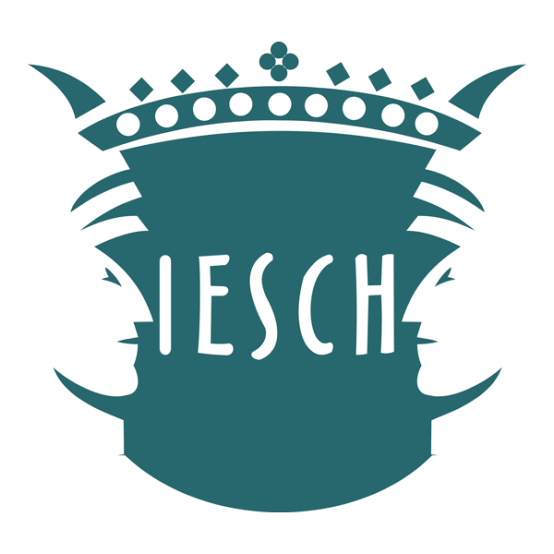

  

  <h1>Portal Web del Colegio de Ingenieros Civiles de Tuxtla Gutiérrez A.C.</h1>

  
Sitio institucional, moderno y accesible, desarrollado para la asignatura <em>Desarrollo de Páginas Web</em>.

  <table>
    <tr>
      <td align="center"></td>
      <td width="60"></td>
      <td align="center"></td>
    </tr>
  </table>

  
  
  
  
  
  

---

## Índice

1. [Descripción del proyecto](#descripción-del-proyecto)
2. [Stack tecnológico](#stack-tecnológico)
3. [Equipo](#equipo)

---

## Descripción del proyecto

El portal moderniza la presencia digital del Colegio y reúne en un solo lugar la información que hoy se consulta por teléfono o en oficina:

- **Trámites** (100 % presenciales): Director Responsable de Obra (DRO), Representante Técnico (RT) y Dictaminador de Riesgos — qué son, qué funciones realizan y cómo contratar a un agremiado.
- **Servicios**: Peritos Valuadores y Cálculo Estructural.
- **Eventos**: Cursos y Capacitación, Asambleas, y un muro de noticias dinámico publicado desde el panel administrativo.
- **Conócenos**: Misión y Visión, organigrama, Comisiones, Estatutos, Servicio Social gratuito y Beneficio a la Sociedad.
- **Afiliación**: requisitos de ingreso, costos y datos bancarios en un pop-up disponible desde cualquier página.
- **Estudio de publicación** (`/admin`): panel conectado a **Supabase** (autenticación, base de datos y almacenamiento) para que el Colegio publique y edite noticias, cursos y asambleas sin tocar código.

> **Regla de negocio importante:** los trámites siguen siendo **presenciales**. El sitio informa y ofrece los formatos para descargar, pero no recibe documentos. Por seguridad, **no se publican datos de contacto de los agremiados**: las solicitudes de especialistas se canalizan por las oficinas del Colegio.

---

## Stack tecnológico

| Herramienta | Para qué la usamos |
| :--- | :--- |
|  | Interfaz construida por componentes. |
|  | Servidor de desarrollo y compilación de producción. |
|  | Navegación entre páginas sin recargar (SPA). |
|  | Animaciones del menú, indicador de sección activa y botón de WhatsApp. |
|  | Todos los íconos del sitio. |
|  | Carrusel de banners en la página de inicio. |
|  | Autenticación, base de datos y almacenamiento del panel `/admin`. |
|  | Un archivo `.css` por componente, con prefijo de clase propio. |
|  | Revisión automática del código (`npm run lint`). |

Tipografías (Google Fonts): **Montserrat** para títulos y botones, **Open Sans** para textos.

---

## Equipo

| Rol | Integrantes |
| :--- | :--- |
| **Desarrollo Web** | Pablo Ángel Ramírez García (líder), Daniel Barrera, María Fernanda Uribe |
| **Diseño** | María Fernanda Uribe, Jocelyn Aguilar |
| **Documentación** | Ignacio Moela, Josué Balbuena, José María Orantes |
