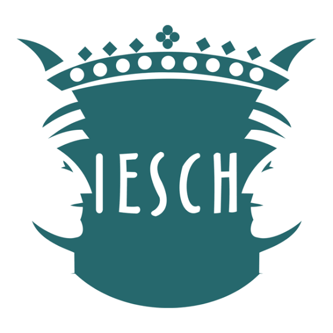

<div align="center">
  

  <h1>Portal Web del Colegio de Ingenieros Civiles de Tuxtla Gutiérrez A.C.</h1>

  <p>Propuesta de sitio institucional, moderno y accesible, desarrollada para la asignatura <em>Desarrollo de Páginas Web</em>.</p>

  <table>
    <tr>
      <td align="center"></td>
      <td width="60"></td>
      <td align="center"></td>
    </tr>
  </table>

  
  
  
  
  
  
  
</div>

---

## Índice

1. [Descripción del proyecto](#descripción-del-proyecto)
2. [Tecnologías](#tecnologías)
3. [Instalación local](#instalación-local)
4. [Estructura del proyecto](#estructura-del-proyecto)
5. [Mapa de rutas](#mapa-de-rutas)
6. [Decisiones de diseño y UX](#decisiones-de-diseño-y-ux)
7. [Convenciones de código](#convenciones-de-código)
8. [Flujo de trabajo con Git](#flujo-de-trabajo-con-git)
9. [Pendientes conocidos](#pendientes-conocidos)
10. [Equipo](#equipo)

---

## Descripción del proyecto

El portal moderniza la presencia digital del Colegio y reúne en un solo lugar la información que hoy se consulta por teléfono o en oficina:

- **Trámites** (DRO, Representante Técnico, Dictaminador de Riesgos): qué son, qué funciones realizan, cómo contratar a un agremiado, su importancia normativa y los requisitos de registro.
- **Servicios** (Peritos Valuadores, Cálculo Estructural, Bolsa de Trabajo).
- **Eventos** (Cursos y Capacitación, Asambleas).
- **Conócenos** (Misión y Visión, valores, organigrama, Comisiones).
- **Afiliación**: requisitos, formatos descargables, costos y datos bancarios en un pop-up desde el menú.
- **Atención por WhatsApp**: preguntas frecuentes y un buzón que abre una conversación con el Colegio.

> **Regla de negocio importante:** los trámites siguen siendo **presenciales**. El sitio informa y ofrece los formatos para descargar, pero no recibe documentos. Por seguridad, **no se publican datos de contacto de los agremiados**: las solicitudes de especialistas se canalizan por las oficinas del Colegio.

---

## Tecnologías

| Herramienta | Para qué la usamos |
| :--- | :--- |
| **React 19** | Interfaz construida por componentes. |
| **Vite 8** | Servidor de desarrollo y compilación de producción. |
| **React Router 7** | Navegación entre páginas sin recargar (SPA). |
| **Framer Motion** | Animaciones del menú, indicador de sección activa y botón de WhatsApp. |
| **Lucide React** | Todos los íconos del sitio. |
| **Swiper** | Carrusel de banners en la página de inicio. |
| **CSS puro** | Un archivo `.css` por componente, con prefijo de clase propio. |
| **Oxlint** | Revisión automática del código (`npm run lint`). |

Tipografías (Google Fonts): **Montserrat** para títulos y botones, **Open Sans** para textos.

---

## Instalación local

**Requisitos:** [Node.js](https://nodejs.org/) 20 o superior y Git.

```bash
# 1. Clonar el repositorio
git clone git@github.com:TheCubick/Proyecto_colegio-web.git
cd Proyecto_colegio-web

# 2. Todo el código vive en la carpeta visuales/
cd visuales

# 3. Instalar dependencias (la primera vez o cuando cambie package.json)
npm install

# 4. Levantar el servidor de desarrollo → http://localhost:5173
npm run dev
```

Otros comandos útiles:

| Comando | Qué hace |
| :--- | :--- |
| `npm run lint` | Busca errores comunes (imports sin usar, variables muertas, etc.). |
| `npm run build` | Compila el sitio en `visuales/dist/`. **Ejecútalo antes de abrir un Pull Request.** |
| `npm run preview` | Sirve la versión compilada para probarla como en producción. |

---

## Estructura del proyecto

```text
web_colegio/
├── README.md
└── visuales/                     Aplicación React + Vite
    ├── index.html                Documento base (lang="es")
    ├── vite.config.js
    ├── public/                   Archivos estáticos, se sirven tal cual desde "/"
    │   ├── documentos/           PDFs descargables (cédula y oficio de inscripción, carta protesta…)
    │   ├── videos/               Videos de fondo de los encabezados (home, vista-aerea, puente-colores…)
    │   └── img/
    │       ├── logos/            logo-colegio (png/svg), logo-uni, logo-carrera
    │       ├── banners/          Fotografías del carrusel de inicio
    │       ├── posts/            Imágenes de publicaciones
    │       ├── paginas/          Fotos por sección: tramites/, servicios/, eventos/
    │       └── documentos/       Organigrama, costos, datos bancarios, tríptico
    └── src/
        ├── main.jsx              Punto de entrada (no es necesario modificarlo)
        ├── App.jsx               Definición de rutas
        ├── styles/
        │   └── index.css         Estilos globales, tokens de tipografía y patrones de fondo
        ├── components/
        │   ├── layout/           Elementos presentes en todas las páginas: Header, Footer
        │   ├── sections/         Bloques de página: Hero, BannerCarrusel, FeatureCards,
        │   │                     AtencionWhatsapp, TramiteDetalle
        │   └── ui/               Piezas reutilizables: ModalContacto
        ├── data/                 Contenido en objetos/arreglos, separado del diseño:
        │                         requisitos, tramitesInfo, asambleas, vacantes
        └── pages/                Vistas completas, agrupadas como en el menú
            ├── Inicio/
            ├── Tramites/         Dro, Rt, Dictaminador
            ├── Servicios/        PeritosValuadores, CalculoEstructural, BolsaTrabajo
            ├── Eventos/          CursosCapacitacion, Asambleas
            └── Conocenos/        MisionVision, Comisiones
```

**Idea clave de la arquitectura:** el *contenido* vive en `src/data/` y el *diseño* en los componentes. Para cambiar un requisito o el texto de un trámite se edita el archivo de datos, sin tocar el JSX. Por ejemplo, `data/tramitesInfo.js` alimenta al componente `TramiteDetalle`, que comparten las tres páginas de Trámites.

---

## Mapa de rutas

| Ruta | Página |
| :--- | :--- |
| `/` | Inicio |
| `/tramites/dro` | Director Responsable de Obra |
| `/tramites/rt` | Representante Técnico |
| `/tramites/dictaminador-de-riesgos` | Dictaminador de Riesgos |
| `/servicios/peritos-valuadores` | Peritos Valuadores |
| `/servicios/calculo-estructural` | Cálculo Estructural |
| `/servicios/bolsa-de-trabajo` | Bolsa de Trabajo |
| `/eventos/cursos-y-capacitacion` | Cursos y Capacitación |
| `/eventos/asambleas` | Asambleas |
| `/conocenos/mision-y-vision` | Misión y Visión |
| `/conocenos/comisiones` | Comisiones |
| cualquier otra | Redirige a Inicio |

Para agregar una página: crea su carpeta en `src/pages/<Menu>/<Pagina>/`, registra la ruta en `App.jsx` y el enlace en el menú de `Header.jsx`.

---

## Decisiones de diseño y UX

### Paleta institucional

| Color | HEX | Uso |
| :--- | :---: | :--- |
|  **Rojo institucional** | `#BA2A33` | Color principal: títulos, botones, íconos |
|  **Rojo oscuro** | `#962E35` | Estados *hover*, degradados, sombras |
|  **Gris oscuro** | `#383637` | Texto principal y bloques de contraste |
|  **Gris claro** | `#E5E5E5` | Fondos de secciones alternas |
|  **Blanco** | `#FFFFFF` | Fondos y texto sobre fondos oscuros |

> **No se usan otros colores** (ni azul ni café). Si necesitas un tono más suave, usa uno de estos con transparencia, p. ej. `rgba(186, 42, 51, 0.1)`.

### Legibilidad para usuarios adultos

La mayoría de los usuarios son ingenieros adultos, muchos con vista cansada. Por eso:

| Decisión | Implementación | Dónde |
| :--- | :--- | :--- |
| Texto base más grande | `18px` en `body`, párrafos de `1.15rem` | `styles/index.css` (`--fs-base`, `--fs-parrafo`) |
| Interlineado amplio | `line-height: 1.7` | `--lh-parrafo` |
| Aspecto de documento técnico | Párrafos justificados con `hyphens: auto` para evitar huecos entre palabras | Clase `.texto-justificado` |
| Menú siempre legible | *Glassmorphism*: fondo blanco al 85 % + `backdrop-filter: blur(12px)`, aunque pase sobre videos | `components/layout/Header/Header.css` |
| Menos "vacío" visual | Patrones sutiles de cuadrícula arquitectónica y puntos | Clases `.fondo-cuadricula` y `.fondo-puntos` |

Para textos nuevos, usa las clases de utilidad:

```jsx
<p className="texto-legible texto-justificado">…</p>
<section className="mi-seccion fondo-cuadricula">…</section>
```

> Los patrones solo definen `background-image`. Si tu sección declara `background: …` en su propio CSS, ese *shorthand* borra el patrón; usa `background-color` en su lugar.

### Accesibilidad

- Atributos `aria-label`, `aria-labelledby` y `aria-current` en la navegación y las secciones.
- Contorno visible al navegar con teclado (`:focus-visible`) en botones y enlaces.
- Respeto a `prefers-reduced-motion`: se desactivan animaciones para quien lo configure en su sistema.
- Videos de fondo silenciados, marcados `aria-hidden` y con una capa oscura para garantizar el contraste del texto.

---

## Convenciones de código

| Qué | Formato | Ejemplo |
| :--- | :--- | :--- |
| Componentes y páginas (`.jsx`) | *PascalCase*, en su propia carpeta | `BolsaTrabajo/BolsaTrabajo.jsx` |
| Estilos | Mismo nombre que el componente | `BolsaTrabajo/BolsaTrabajo.css` |
| Datos (`.js`) | *camelCase* | `requisitos.js`, `tramitesInfo.js` |
| Clases CSS | Prefijo corto del componente + *kebab-case* | `dro-hero`, `td-paso`, `hd-menu` |
| Archivos en `public/` | minúsculas, *kebab-case*, **sin espacios, acentos ni "ñ"** | `datos-bancarios.jpg` |
| Rutas (URL) | minúsculas, *kebab-case* | `/tramites/dictaminador-de-riesgos` |

El prefijo en las clases evita que los estilos de una página afecten a otra; revisa que el tuyo no lo use nadie más.

**Antes de subir cambios, verifica que:**

- [ ] No queden `console.log` ni `debugger`.
- [ ] `npm run lint` no reporte imports o variables sin usar.
- [ ] Solo se usen colores de la paleta.
- [ ] Las rutas a imágenes y PDFs existan en `public/` (respetando mayúsculas y minúsculas).
- [ ] `npm run build` termine sin errores.

---

## Flujo de trabajo con Git

> **Regla de oro:** nunca trabajes directamente sobre `main`. Todo cambio entra por *Pull Request*.

### Tipos de rama

| Prefijo | Cuándo usarlo | Ejemplo |
| :--- | :--- | :--- |
| `feat/` | Nueva página, sección o funcionalidad | `feat/pagina-comisiones` |
| `fix/` | Corrección de un error | `fix/pdf-requisitos-dro` |
| `refactor/` | Reorganizar código sin cambiar lo que hace | `refactor/estructura` |
| `docs/` | Solo documentación | `docs/manual-tecnico` |

### Paso a paso

```bash
# 1. Parte siempre de main actualizado
git checkout main
git pull origin main

# 2. Crea tu rama
git checkout -b feat/nombre-de-tu-tarea

# 3. Trabaja y prueba
npm run dev

# 4. Guarda tus avances con commits pequeños y descriptivos
git add src/pages/Conocenos/Comisiones
git commit -m "Feat: tarjetas de integrantes en Comisiones"

# 5. Antes de subir, trae lo último de main para resolver conflictos en tu rama
git pull origin main
npm run build

# 6. Sube tu rama
git push -u origin feat/nombre-de-tu-tarea
```

### Mensajes de commit

Usamos el formato `Tipo: descripción en español`, igual que el historial del repositorio:

| Tipo | Uso |
| :--- | :--- |
| `Feat:` | Algo nuevo para el usuario |
| `Fix:` | Corrección de un error |
| `Refactor:` | Cambio interno sin efecto visible |
| `Design:` | Ajustes visuales o de estilos |
| `Docs:` | Documentación |

### Pull Request

1. En GitHub, haz clic en **"Compare & pull request"** sobre tu rama.
2. Título con el mismo formato del commit (ej. `Feat: página de Comisiones`).
3. En la descripción indica **qué cambiaste**, **cómo probarlo** y, si es visual, agrega una captura.
4. Asigna a un compañero de Desarrollo Web como revisor.
5. Atiende los comentarios con nuevos commits en la misma rama.
6. Una vez aprobado, el responsable lo une a `main` y se borra la rama.

---

## Pendientes conocidos

- **PDFs faltantes en `public/documentos/`:** el código enlaza `requisitos-dro.pdf`, `requisitos-rt.pdf`, `requisitos-dictaminador.pdf` y `temario-precios.pdf`, pero aún no existen. Mientras no se agreguen, esos botones de descarga fallan.
- **Fotografías de páginas:** algunas vistas muestran "Imagen pendiente" hasta que se agregue su foto en `public/img/paginas/`.
- **Tamaño del paquete:** el JavaScript compilado supera los 500 kB; se puede dividir con carga diferida de páginas (`React.lazy`).

---

## Equipo

| Rol | Integrantes |
| :--- | :--- |
| **Desarrollo Web** | Pablo Ramírez, Daniel Barrera |
| **Diseño UI/UX** | Jocelyn Aguilar, Maria Fernanda Uribe |
| **Documentación y Análisis** | Ignacio Moela, Jose Maria Orantes, Josue Balbuena |
